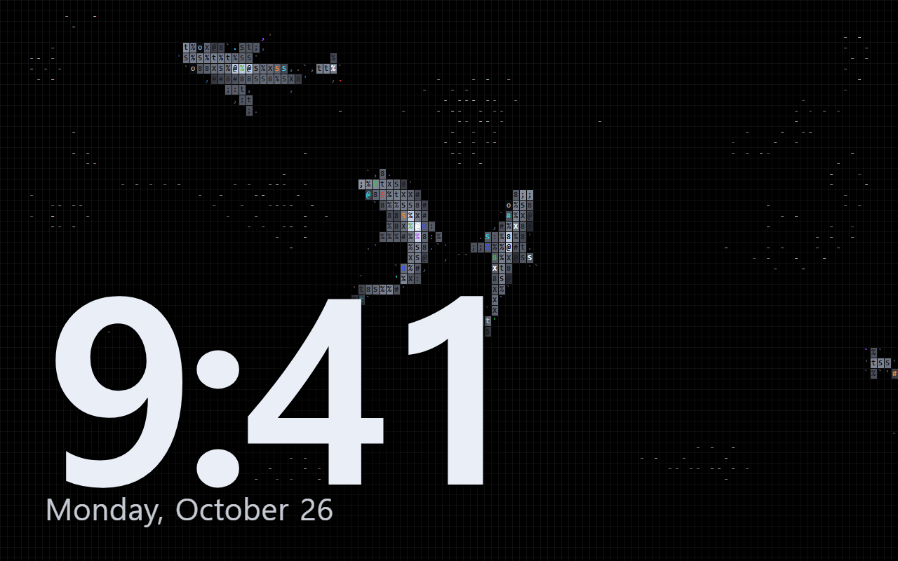
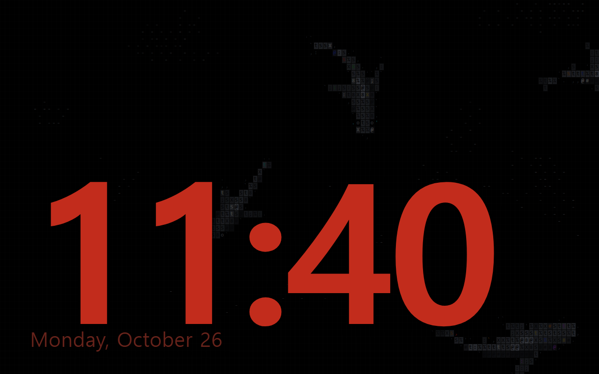
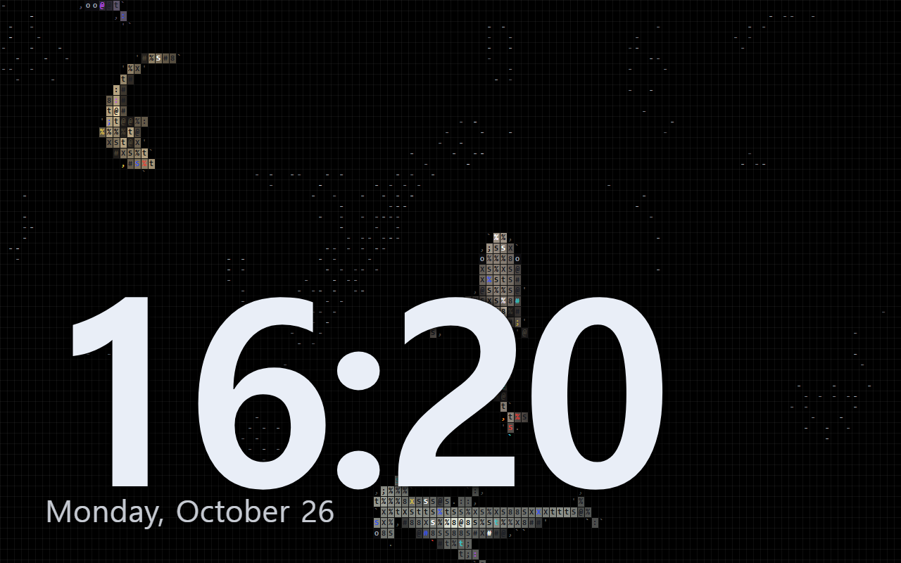

<div align="center">

# frame-reef

**Turn a cheap Android photo frame into a living ASCII shark aquarium with a clock.**

Wes Bos showed how to take over a $50 photo frame and run your own page on it. frame-reef is a page worth running: the ASCII sharks of [ascii-sharks](https://github.com/stackedlol/ascii-sharks) hunting real schools of fish, behind a big clock that turns red and dim at night.

 

Works with **Claude Code** and **Codex**.



</div>

## Quick start
```bash
git clone https://github.com/Dodai0419/frame-reef && cd frame-reef
node build.mjs
```
```
wrote frame-reef.html (64.5 KB, one file, works offline)
```
Open `frame-reef.html` full screen on the frame, a tablet or any spare monitor. Node.js 22.13+ to build; nothing to install, no network at run time.

## Gallery

| | |
|---|---|
|  | **Day.** `frame-reef.html?t=9:41`. Four sharks hunt schools of fish; fleeing fish break around them and the water lights up where they swim. The clock and date are the photo-frame dashboard's ambient screen. |
|  | **Night.** From 22:00 to 06:00 the ocean dims to 22% and the clock turns red, like the dashboard's night mode, so the frame does not light up a bedroom. `?night=23-7` moves the window. |
|  | **Pick your sharks.** `?sharks=hammerhead,tiger,zebra,thresher&h24=1`. Eight species from ascii-sharks: classic, hammerhead, great hammerhead, tiger, zebra, mako, thresher and nurse, each with its own body, fins and markings. |

Every picture is a screenshot of the built page in headless Chrome at 1280 × 800, the photo-frame dashboard's design size.

## The problem
- A hacked photo frame needs something to show. Photo slideshows get old and a dashboard needs accounts, APIs and a build.
- Always-on screens burn in when a clock sits on the same pixels for months.
- ascii-sharks is a beautiful hero animation, but it ships as TypeScript for a vite dev server, not as a page you can copy to a frame.

## The solution
| Idea | Fixes |
|------|-------|
| **One offline HTML file.** The ascii-sharks source, unchanged, turned into one classic script by Node's built-in TypeScript stripping. | No npm install, no vite, no tsc, no network on the frame. |
| **The photo-frame dashboard's ambient screen.** Big clock and date, red dim night clock from 22:00 to 06:00, a 4 px shift of the clock every minute. | Readable from across the room, dark at night, no burn-in. |
| **URL options.** `?sharks=`, `?night=`, `?h24=1`, `?clock=0`. | Change it without rebuilding. |

## Put it on a frame
1. Get ADB and a full-screen browser or kiosk on the frame: follow [wesbos/photo-frame-dashboard](https://github.com/wesbos/photo-frame-dashboard) for your model. Frames with the same name can have different boards; check its device index first.
2. Then either copy the file and open it in the frame's browser:
   ```bash
   adb push frame-reef.html /sdcard/Download/
   ```
   or serve it from your computer and point the kiosk at `http://<computer-ip>:8000/frame-reef.html`:
   ```bash
   python -m http.server 8000
   ```
3. No frame? Any old tablet or monitor works: open the file, go full screen.

Tap the screen and the fish scatter (ascii-sharks' splash). The ocean runs on the frame's CPU. ascii-sharks pauses when the page is hidden and shows a still frame when the device asks for reduced motion.

## FAQ

**Will it run on my frame's old browser?**
The page needs a browser from roughly 2020 or later (class fields, `URLSearchParams`, `ResizeObserver`). Many frames ship an old system WebView; the photo-frame-dashboard guides show how to install a current browser or kiosk app first. Not tested on a physical frame yet.

**Does it need the internet?**
No. Everything, including the ocean, is inside the one HTML file. The clock uses the frame's own time.

**How much power or CPU does it use?**
It is ascii-sharks' animation at the browser's frame rate, so it costs about as much as the original page. It stops drawing when the page is hidden.

**Why does the clock move?**
Every minute it shifts by up to 4 pixels in a random direction, like the photo-frame dashboard does, so the digits never sit on the same pixels for months and burn in.

**Can I use it without the clock?**
Yes: `frame-reef.html?clock=0`.

**Can I change the night hours?**
Yes: `?night=23-7` means 23:00 to 07:00. `?night=0-0` turns night mode off.

## Use with Claude Code
```bash
/plugin marketplace add Dodai0419/frame-reef
/plugin install frame-reef@frame-reef
```
Then ask: *"Make my photo frame an aquarium with hammerheads and a 24-hour clock."*

## Use with Codex (ChatGPT)
```bash
git clone https://github.com/Dodai0419/frame-reef && cp -r frame-reef/skills/* ~/.codex/skills/
```
Or copy `AGENTS.md` into your project root.

## Benchmarks
Windows 11, Node.js 24.20.0, `node bench/bench.mjs 20`, run 3 times.

| | ascii-sharks (a0074c1) + photo-frame-dashboard (0bff55e) | frame-reef |
|---|---|---|
| same ocean | `npm install && npm run dev` (vite) | the same `src/*.ts` files, byte for byte (sha256 checked), and the bundled page draws the same glyphs, cells and colours as the original modules for 60 seeded frames (`tests/frame_reef.test.mjs`) |
| to get a page onto a frame | ascii-sharks: vite + typescript dev dependencies; dashboard: vite + wrangler, `vite build` | `node build.mjs`, no packages |
| build time | not measured (needs `npm install`) | 29-44 ms in-process (median of 20), 0.5-1.1 s for the whole `node build.mjs` command |
| output | a dev server or a `dist/` folder | one 64.5 KB HTML file |
| own code | dashboard ambient view + its app.js helpers | `build.mjs`, 113 lines (bundler, clock, night mode, page) |

The animation itself is ascii-sharks' code, so it runs exactly as fast as the original; there is no speed claim for it.

## Inspired by
- [stackedlol/ascii-sharks](https://github.com/stackedlol/ascii-sharks) — the ocean: boids fish schools, hunting sharks, the ASCII renderer (vendored unchanged).
- [wesbos/photo-frame-dashboard](https://github.com/wesbos/photo-frame-dashboard) — taking over the frame, and the ambient clock, night mode and burn-in shift (ported).

## Roadmap
- [ ] Photo breaks: show the frame's own photos for a minute every hour.
- [ ] Weather line under the date (no API key, open-meteo).
- [ ] A ready-made APK wrapper for frames without a browser.

## License
MIT. Portions from the two projects above, see [NOTICE](NOTICE).
